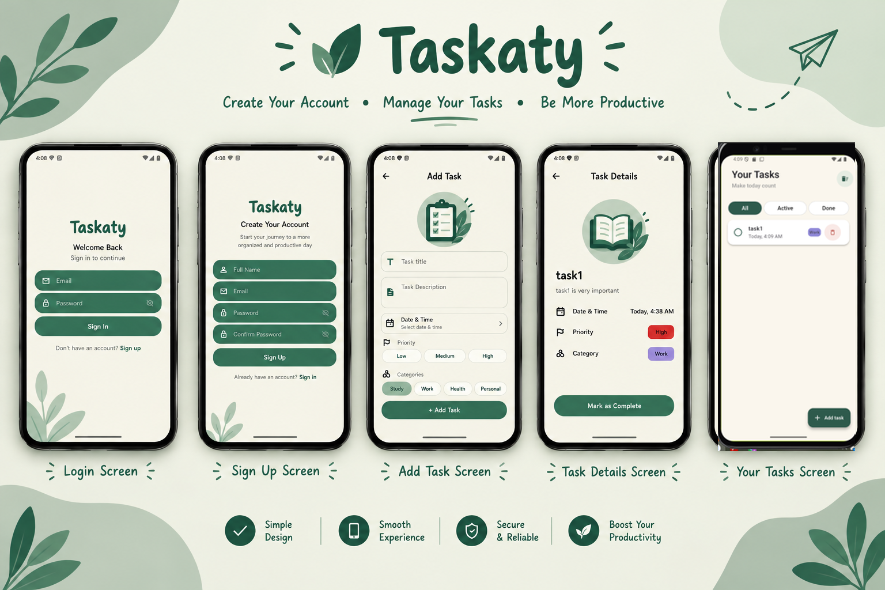

# Taskaty — Flutter Task Management App

Taskaty is a Flutter-based task management application that helps users organize their tasks, track their progress, and manage deadlines through a custom-designed user interface. The app uses Firebase Authentication for account management and Cloud Firestore for storing and synchronizing task data.

## Features

- **User Authentication:** Register and log in using Firebase Authentication.
- **Task Management:** Add, view, and delete tasks.
- **Task Details:** Open a dedicated screen to view task details.
- **Task Status:** Mark tasks as Pending or Completed.
- **Task Filtering:** View all tasks, active tasks, or completed tasks from the *Your Tasks* screen.
- **Due Date and Time:** Set a deadline for each task by selecting a date and time.
- **Priority Levels:** Assign a priority to each task.
- **Task Categories:** Organize tasks by assigning categories.
- **Clear All:** Clear all tasks using the available Clear All functionality.
- **Cloud Database:** Store tasks in Cloud Firestore.
- **Real-Time Updates:** Use Firebase streams to automatically reflect task data changes in the UI.
- **Custom UI:** Use a custom-designed interface and reusable Flutter widgets.

## Screenshots

Here is a preview of the Taskaty application screens.



## Tech Stack

- **Flutter** — Cross-platform UI development
- **Dart** — Programming language
- **Firebase Authentication** — User registration and login
- **Cloud Firestore** — Cloud database and real-time data updates

## Requirements

Before running the project, make sure you have:

- Flutter SDK installed and configured.
- Dart SDK compatible with your Flutter version.
- Android Studio or VS Code.
- An Android emulator, iOS simulator on macOS, or a connected device.
- A Firebase project configured for the application.

## Getting Started

### 1. Clone the repository

```bash
git clone https://github.com/Basmala88/Taskaty.git
```

### 2. Open the project

```bash
cd Taskaty
```

### 3. Install dependencies

```bash
flutter pub get
```

### 4. Configure Firebase

The application requires Firebase configuration to use authentication and Cloud Firestore.

1. Create or select a Firebase project in the [Firebase Console](https://console.firebase.google.com/).
2. Register the appropriate app platform in your Firebase project.
3. Configure Firebase for the local project using the required platform-specific configuration files and settings.
4. Enable **Email/Password** authentication if that is the sign-in method configured in the application.
5. Create a Cloud Firestore database and configure its security rules appropriately.

Make sure the Firebase configuration matches your local setup before running the app. Do not commit private credentials or service account keys to the repository.

### 5. Run the application

```bash
flutter run
```

## Project Structure

The project follows a modular structure, with application code, reusable widgets, data handling, and task-related screens organized into separate files and folders.

- `lib/` — Main Dart application code.
- `assets/` — Application assets.
- `android/` — Android platform files.
- `ios/` — iOS platform files.
- `web/` — Web platform files.
- `pubspec.yaml` — Project dependencies and configuration.

## Current Task Workflow

Users can create tasks, assign categories and priorities, set due dates and times, view task details, and track their progress. The *Your Tasks* screen provides filters for all tasks, active tasks, and completed tasks. Task status can currently be changed between Pending and Completed.

## Future Improvements

Additional features and enhancements may be introduced as development continues.

## Author

**Basmala Ahmed Abdelsabour**

GitHub: [Basmala88](https://github.com/Basmala88)

---

*Built with Flutter and Firebase.*
